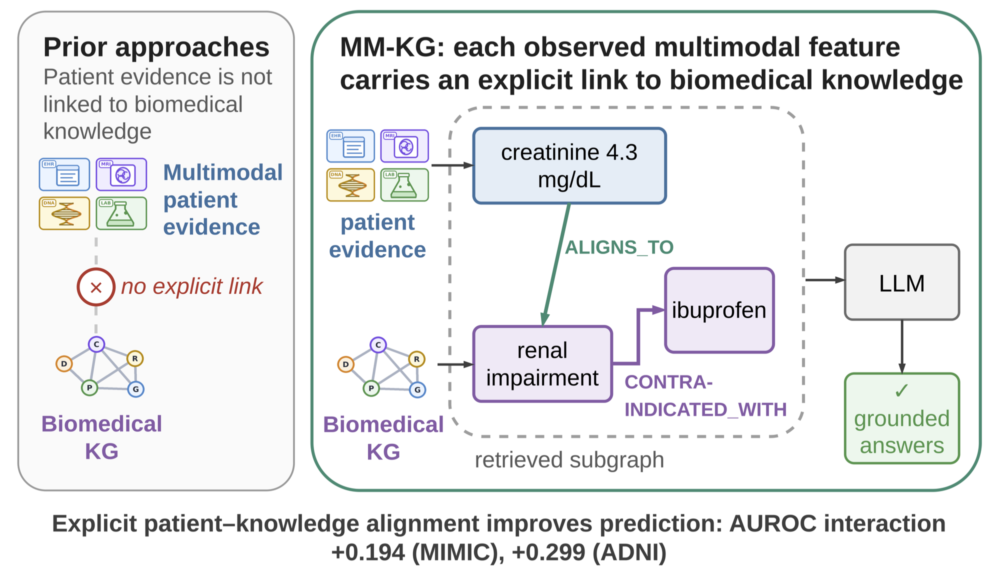

# Multimodal Knowledge Graphs: Aligning Multimodal Patient Evidence with Biomedical Knowledge Graphs for Clinical LLMs

#### By [Jiawen Du](https://scholar.google.com/citations?user=4-A82CkAAAAJ&hl=en), [Arshan Ali Khan\*](https://github.com/arshan-ak), [Chenhao Zhang\*](https://github.com/Chance-hao), [Zachary Plotkin](https://www.linkedin.com/in/zacharyaplotkin/), [Li Shen](https://www.med.upenn.edu/shenlab/), [Qi Long](https://www.med.upenn.edu/long-lab/), [Yun Li](https://yunliweb.its.unc.edu/), [Can Chen](https://sdis.unc.edu/person/can-chen/), [Tianlong Chen](https://tianlong-chen.github.io/) and [Nicholas Konz](https://nickk124.github.io/).

\*Equal contribution.

arXiv paper link: [](https://arxiv.org/abs/2610.06685)

<p align="center">
  
</p>

This is the code for our paper [**Aligning Multimodal Patient Evidence with Biomedical Knowledge Graphs for Clinical LLMs**](https://arxiv.org/abs/2610.06685), where we introduce **MM-KG** (Multimodal Knowledge Graph). MM-KG keeps a patient's multimodal evidence (EHR codes and text, imaging, lab measurements, genomic and biospecimen data) and a biomedical knowledge graph as two separate layers of one typed graph, joined by explicit alignment edges. Because each alignment edge is an individually addressable object, patient evidence, knowledge, and the links between them can each be retrieved, traced to their source, withheld or corrupted, which is how the paper measures what each one contributes.

### Why use MM-KG?

Many clinical questions require connecting something observed in a patient (a creatinine of 4.3 mg/dL) to a relation in biomedical knowledge (ibuprofen is contraindicated in renal impairment). Methods that fuse multimodal patient data into a single representation cannot say which observation supported an answer, or remove one source at a time to test it. Knowledge-graph methods typically build the patient side from structured codes or clinical text alone, and supply knowledge as background context rather than as links to specific observations. MM-KG stores the connection as an edge in the graph. In the paper we find that:

* **Patient evidence and knowledge are complementary.** On questions that need both sources, neither patient evidence alone nor the knowledge graph alone performs far above chance, while their combination gives a drug-controlled AUROC interaction of +0.194 on MIMIC-IV and +0.299 on ADNI.
* **The gain comes from the explicit links.** On held-out five-candidate ranking, MM-KG outperforms MindMap by +0.131 Hits@1 and leads an adapted GraphCare on the items that require consulting the patient. Deleting the single answer-bearing relation from the retrieved packet returns Hits@1 to the no-knowledge baseline.
* **Retrieval is compact.** Query-conditioned retrieval reaches 0.731 AUROC with 6.8× less context than the strongest generic retrieval policy.
* **The method is not tied to one dataset.** Graph construction, retrieval and the downstream models depend only on the graph schema. This repository builds MM-KG for MIMIC-IV / MIMIC-CXR / MIMIC-IV-Note with PrimeKG; the paper's second instantiation (ADNI) uses the same schema with its own harmonizers.

**Using this code, you can:**

1. Build an MM-KG from MIMIC-IV, MIMIC-CXR and MIMIC-IV-Note, aligned to PrimeKG through UMLS.
2. Reproduce the paper's MIMIC experiments: the 2×2 factorial design (patient evidence × knowledge graph), retrieval policies, candidate ranking against MindMap and GraphCare, fact-checking and knowledge-graph validation, and ICU mortality prediction with an LLM or a GNN.
3. Build an MM-KG for your own cohort and knowledge graph.

Please follow the steps outlined below to do these.

### How MM-KG works

<p align="center"></p>

1. **Harmonizers.** Each modality has its own harmonizer, which converts raw data into typed observation nodes mapped to UMLS concepts. Each observation keeps a pointer to its source record and recording time, and observations from different modalities stay distinct even when they map to the same concept.
2. **Aligner.** The aligner gives each observation at most one `aligns-to` edge to a knowledge-graph (PrimeKG) concept, preferring exact identifiers, then synonyms, then parent concepts. Deleting that one edge detaches the observation from the knowledge graph and leaves the rest of the graph unchanged.
3. **Query-conditioned retrieval.** For a question about a patient, retrieval returns two components: the patient's observations available at prediction time, and the knowledge-graph relations of the entities named in the question (each candidate's *packet*). Both are selected by deterministic rules with no access to the label.
4. **Downstream model.** An LLM receives the subgraph as short natural-language statements grouped by source channel (or as typed triples); a heterogeneous GNN propagates node features from frozen text and image encoders over the graph.

## Citation

Please cite our paper if you use our code or reference our work:

```bib
@article{du2026aligning,
  title={Aligning Multimodal Patient Evidence with Biomedical Knowledge Graphs for Clinical LLMs},
  author={Du, Jiawen and Khan, Arshan Ali and Zhang, Chenhao and Plotkin, Zachary and Shen, Li and Long, Qi and Li, Yun and Chen, Can and Chen, Tianlong and Konz, Nicholas},
  journal={arXiv preprint arXiv:2610.06685},
  year={2026}
}
```

## Repository layout

```text
graph/       cohort, modality harmonizers, concept alignment, PyG export, GNN outcome models
tasks/       question benchmarks and LLM experiments: 2×2 factorial, fact-checking, KG validation, ICU mortality
retrieval/   retrieval policies (exp1), candidate ranking (exp2), GraphCare / MindMap baselines (exp4), unit tests
figs/        README figures
```

Run the scripts in the order listed below. Each writes to `<folder>/outputs/`, which is git-ignored because everything derived from MIMIC and UMLS is credentialed data.

## 1) Installation

The code requires Python ≥ 3.10. The scripts use three separate environments, and most scripts name theirs at the top of their docstring (e.g., `env: umls_eval`). Keeping them separate avoids version conflicts between vLLM and PyTorch Geometric.

| environment | main packages | used for |
| --- | --- | --- |
| `umls_eval` | pandas, spaCy, medspaCy, QuickUMLS | cohort, concept linking, patient tables, benchmarks, analysis (CPU) |
| `torch_gpu` | PyTorch, PyTorch Geometric, transformers, open_clip, timm, scikit-learn | imaging harmonizer, node embeddings, GNNs, GraphCare baseline |
| `llm_qwen` | vLLM, tiktoken | prompt construction and LLM scoring; a 48 GB GPU serves the 35B GPTQ model |

For `torch_gpu`, first install [PyTorch](https://pytorch.org/get-started/locally/) for your CUDA version. Then install the corresponding group from `requirements.txt` into each environment (the file is divided into the three groups by comments). pandas, NumPy and pyarrow are used in all three.

## 2) Data

None of the data is redistributed. You need:

* credentialed access to [MIMIC-IV v3.1](https://physionet.org/content/mimiciv/), [MIMIC-CXR-JPG v2.1.0](https://physionet.org/content/mimic-cxr-jpg/) and [MIMIC-IV-Note v2.2](https://physionet.org/content/mimic-iv-note/);
* the [PrimeKG](https://github.com/mims-harvard/PrimeKG) release, with the `mondo.sssom.tsv` mapping file from a [Mondo](https://github.com/monarch-initiative/mondo) release placed next to the PrimeKG files;
* a [UMLS](https://www.nlm.nih.gov/research/umls/) Metathesaurus (`META/` RRF files).

Set `MMKG_HOME` and arrange the data under it as below, or point each environment variable in the table at your own copy.

```bash
export MMKG_HOME=/path/to/mmkg_home
```

```text
$MMKG_HOME
├── data
│   ├── mimiciv/3.1                 # hosp/*.csv.gz, icu/icustays.csv.gz
│   ├── mimic-cxr-jpg/2.1.0         # files/, metadata and CheXpert label CSVs
│   ├── mimic-iv-note/2.2/note      # radiology.csv.gz, radiology_detail.csv.gz
│   ├── primekg                     # kg.csv, nodes.tab, *_features.tab, mondo.sssom.tsv
│   └── umls/2026AA/META            # MRCONSO.RRF, MRREL.RRF, MRSAT.RRF, MRSTY.RRF
└── .cache
    ├── quickumls_index
    └── huggingface
```

| variable | default |
| --- | --- |
| `MIMIC_IV_DIR` | `$MMKG_HOME/data/mimiciv/3.1` |
| `MIMIC_CXR_DIR` | `$MMKG_HOME/data/mimic-cxr-jpg/2.1.0` |
| `MIMIC_NOTE_DIR` | `$MMKG_HOME/data/mimic-iv-note/2.2/note` |
| `PRIMEKG_DIR` | `$MMKG_HOME/data/primekg` |
| `UMLS_META_DIR` | `$MMKG_HOME/data/umls/2026AA/META` |
| `QUICKUMLS_INDEX` | `$MMKG_HOME/.cache/quickumls_index` |
| `HF_HOME` | `$MMKG_HOME/.cache/huggingface` |

Build the QuickUMLS index once (in `umls_eval`):

```bash
python -m quickumls.install -L -U -E ENG $UMLS_META_DIR $QUICKUMLS_INDEX
```

The scripts run with `HF_HUB_OFFLINE=1`, so download the models into `HF_HOME` beforehand. The last two are only needed for the replications, and Llama is a gated model that requires accepting its license on Hugging Face. With `huggingface_hub` older than 0.34, use `huggingface-cli download` instead of `hf download`.

```bash
for m in microsoft/BiomedCLIP-PubMedBERT_256-vit_base_patch16_224 \
         cambridgeltl/SapBERT-from-PubMedBERT-fulltext \
         microsoft/BiomedNLP-BiomedBERT-base-uncased-abstract \
         emilyalsentzer/Bio_ClinicalBERT \
         Qwen/Qwen3.5-35B-A3B-GPTQ-Int4 \
         Qwen/Qwen3.5-9B meta-llama/Llama-3.1-8B-Instruct; do
  hf download "$m"
done
```

## 3) Build the graph

Steps marked `(array)` process shards in parallel when `WG_NSHARDS` (shard count) and `SLURM_ARRAY_TASK_ID` (shard index) are set, under any scheduler; if unset, they run everything in one process.

```bash
cd graph
python 00_mrconso_subset.py          # UMLS CUI/SAB/CODE projection for the bridge
python build_crosswalk.py            # concept -> PrimeKG bridge tables
python 01_whole_cohort.py            # cohort: chest film ∧ admission ∧ ≥1 diagnosis
python 02_biomedclip_findings.py     # imaging harmonizer (array)
python 02b_merge_imaging.py
python 03a_prep_reports.py           # report harmonizer
python 03b_report_findings.py        # (array)
python 03c_merge_reports.py
python 04_patient_tables.py          # patient nodes/edges + ALIGNS_TO_CUI alignment edges
python 05_build_pyg.py               # + clinical PrimeKG; graph summary
python 06_sapbert_names.py           # node features
python 07_pubmedbert_desc.py
python 08_bioclinbert_reports.py     # (array)
python 08b_merge_reports_emb.py
python 09_build_pyg_embed.py         # PyG HeteroData with pretrained features
```

## 4) Run the experiments

Run 4a first: 4b and 4c read its outputs.

### 4a) Patient-specific join questions and the 2×2 factorial

All four arms receive the question and the conventional patient record. B adds the retrieved patient modalities, C adds the retrieved knowledge-graph packets, and D adds both. The headline quantity is the interaction (D − C) − (B − A).

```bash
cd tasks
python 00_build_rel_cache.py                     # PrimeKG relation cache
python 02a_medsafety_kg.py                       # relations of each patient's own drugs and conditions
(cd ../graph && python 13_icu_ihm_features.py)   # ICU cohort, 48 h window
python 12_build_mm_bundles.py                    # multimodal bundles; also writes the CUI-name table read by 18
python 18_build_composite_wide.py
python 23_prepare_v2_benchmark.py                # 3,200-item benchmark, matched negatives
python 19_composite_wide_llm.py --model Qwen/Qwen3.5-35B-A3B-GPTQ-Int4 --tag widev2_q35 \
    --benchmark composite_benchmark_wide_v2.jsonl --max_model_len 8192    # arms A-D + leave-one-channel-out
python 19_composite_wide_llm.py --tag widev2_q35 --benchmark composite_benchmark_wide_v2.jsonl --analyze_only
```

Add `--arms C_alt D_alt --max_model_len 32768` for the typed-triple rendering of the knowledge graph, use `--model Qwen/Qwen3.5-9B` or `--model meta-llama/Llama-3.1-8B-Instruct` for the replications, and run `26_subset_interactions.py` for the subset analyses.

### 4b) Retrieval policies, candidate ranking and external baselines

Every script in `retrieval/` checks the digests of its frozen inputs and logs its configuration under `retrieval/outputs/`. These scripts take a short model key (`q35`, `q9`, `m3`; defined in `retrieval/common/paths.py`) instead of a Hugging Face model ID.

```bash
cd retrieval
python stage0_audit/freeze_subsets_and_splits.py    # patient-level dev/test split

cd exp1_retrieval                                   # retrieval policies R0-R5
python 01_build_evidence_collection.py
python 02_build_kg_onehop_cache.py
python 03_build_contexts.py --policy R4 --split test --budget natural --tag R4_test_bnatural
python 05_score_contexts.py --model q35 --max_model_len 8192 --tags R4_test_bnatural ...
python 06_analyze.py --model q35 --split test --tags ... --ref R4_test_bnatural

cd ../exp2_ranking                                  # five-candidate ranking
python 01_build_ranking_benchmark.py --max_total_dist 12
python 02_build_contexts.py --version ranking_v1_d12 --split test --arm D --policy R4q --control none
python 03_score_ranking.py --model q35 --max_model_len 8192 --tags ...
python 04_analyze.py --version ranking_v1_d12 --model q35 --split test --tags ...
```

* `--tags` takes the `--tag` names given to the context builders; build one context set per policy (`--policy R0` ... `R5`) or arm (`--arm A` ... `D`, plus controls and channel ablations). Policy `R2` (vector retrieval) needs `04_embed_chunks.py` first.
* `--kg_order round_robin` and `--budget match_r4|2048|4096` give the ordering and token-budget controls.
* `exp4_baselines/` holds the external baselines: GraphCare (`03`, `04`, `07`; ranking: `08`, `09`), MindMap (`05`, `06`; ranking: `10`), and their analysis (`11`, `12`).

### 4c) Fact-checking, knowledge-graph validation and outcome prediction

```bash
cd tasks
python bridge_v2_diagnoses.py                    # ICD -> PrimeKG bridge v2 (20-30 min)
python bridge_v2_drugs.py                        # drug -> PrimeKG bridge v2 (25-40 min)
python bridge_v2_validate.py
python 09a_build_audit_cohort.py
python 06a_build_extended_benchmark.py --complete
python 06_extended_audit_llm.py --model Qwen/Qwen3.5-35B-A3B-GPTQ-Int4 \
    --benchmark extended_benchmark_complete.jsonl --tag complete --max_model_len 16384
python 07_external_validation.py                 # prescribing-behaviour validation of PrimeKG
python 08a_refine_contraindications.py
python 13_mm_ablation_llm.py --tag ihm           # LLM ICU-mortality channel ablation (needs 12, from 4a)
cd ../graph
WG_FINETUNE=1 python 13_icu_ihm_whole.py         # GNN ICU-mortality channel ablation
python 13c_gnn_paired.py
```

## 5) Use MM-KG on your own data

The construction, retrieval and downstream-model code depend only on the graph schema, not on MIMIC or PrimeKG. To build an MM-KG for another cohort or knowledge graph:

1. Write harmonizers that emit the node/edge tables of `graph/04_patient_tables.py`: concept-keyed observation nodes, one edge type per derivation route, and provenance in keys and attributes.
2. Build bridge tables from your concept namespace to your knowledge graph's node indices (`graph/build_crosswalk.py`).
3. Define the relation layers of your question families and the occult-state rules of your cohort (`LAYER` and `LAB_STATES` in `tasks/18_build_composite_wide.py`).

Everything downstream runs unchanged.

## Acknowledgements

We thank the providers of PrimeKG (Chandak, Huang & Zitnik, 2023), MIMIC-IV / MIMIC-CXR / MIMIC-IV-Note (PhysioNet), UMLS, the Mondo Disease Ontology, and the open models listed above. `retrieval/exp4_baselines/graphcare_model.py` is adapted from the [GraphCare](https://github.com/pat-jj/GraphCare) authors' code (MIT License); MindMap is re-implemented from the paper.

The code is released under the [MIT License](LICENSE). It is a research artifact, not a clinical decision tool.
